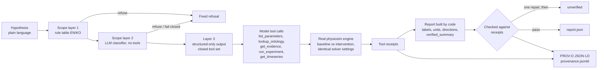

# Ontology-Physiology Lab

Ontology-Physiology Lab is a research tool for running small in-silico cardiovascular experiments from a plain-language model hypothesis. A deterministic closed-loop ODE engine (a six-compartment Phase 1 model and an eight-volume four-chamber model, "M1") is annotated with ontology concepts (Uberon, FMA, OBO Relations Ontology, a Smith et al. 2004 CellML evidence/SHACL layer). On top of it, an experiment agent lets a language model map a hypothesis such as "triple mitral resistance in M1" to engine parameters, call the real engine through tools, and choose which runs and metrics to report. The report itself is built by code from tool receipts and checked against them; the model's free prose is discarded. Each session leaves a W3C PROV-O record.

> **Safety.** All data are synthetic. Nothing here is clinically validated, patient-specific, or medical advice. Parameter defaults are exploratory, not fitted to literature; the Phase 1 baseline is elevated-pressure and must not be described as a healthy adult reference. The agent refuses personal-health, diagnosis, treatment, drug and dosing questions (an English/Korean rule table plus an LLM scope classifier; neither is proof against every paraphrase). **Not for diagnosis, treatment selection or patient-specific prediction.**

Public research site: <https://medical-ontology-research.pages.dev/> — ontology graph viewer (`/graph/`), in-browser simulation (`/simulate/`), `/methodology/`, `/references/`, demos, and `/lab/`, which re-runs the recorded experiments in the browser and re-verifies every claim. Author: Sungyeob Lim, College of Medicine, Soonchunhyang University.

## Built during the Meta Global AI Developer Hackathon

Event period: 2026-10-26 to 2026-11-04. The GitHub repository was created on 2026-10-30. The first commit is dated 2026-10-31 and the most recent commit at the time of writing is dated 2026-11-02; **every commit in the history is dated inside the event period** (history preserved from the original private repository; sensitive strings and some third-party text redacted, see [REDACTIONS.md](REDACTIONS.md) and [RIGHTS.md](RIGHTS.md)). Commit hashes changed because of the redaction.

**Nothing in this repository predates the event except the third-party inputs listed in [NOTICE.md](NOTICE.md).** The one related earlier project, CardioLab ([Carraway-and-Gatsby/cardiac-simulator](https://github.com/Carraway-and-Gatsby/cardiac-simulator), created 2026-10-23, MIT), was reviewed only and not incorporated ([docs/ecosystem.md](docs/ecosystem.md)).

| Date (commit dates, as recorded) | What was built | Where |
| --- | --- | --- |
| 2026-10-31 | Phase 1 closed-loop engine, 34 annotated variables, semantic benchmark, evidence ledgers, reproducibility scripts; synthetic research CI | `src/physiosim/`, `docs/`, `results/phase1/` |
| 2026-10-31 | Integration stabilisation across valve transitions; separation of same-integrator replay from independent solver comparison | `src/physiosim/simulation/`, [docs/independent_verification.md](docs/independent_verification.md) |
| 2026-10-31 to 2026-11-01 | Smith et al. 2004 evidence layer: canonical CellML source and CC BY 3.0 record, OpenCOR reference runs and comparison, literature evidence review, SHACL shapes, PROV-O record of the OpenCOR runs | `docs/evidence/`, `docs/evidence_review/` |
| 2026-11-01 | Anatomical node specification v2, applied to the SHACL layer and the runtime registry; bqbiol vocabulary decision | `src/physiosim/ontology/anatomy_nodes_v2.json`, `docs/evidence_review/` |
| 2026-11-01 | Four-chamber M1 engine (passive atria, eight volumes) and a synthetic demo | [docs/physiology_four_chamber_m1.md](docs/physiology_four_chamber_m1.md), `scripts/run_four_chamber_m1.py` |
| 2026-11-01 to 2026-11-02 | Applied LA–mitral–LV sidecar, review fixes, wheel portability | [docs/applied_la_mitral_lv.md](docs/applied_la_mitral_lv.md), `src/physiosim/ontology/applied_la_mitral_lv.py` |
| 2026-11-02 | Ontology graph viewer | `tools/ontology_graph_view/` |
| 2026-11-02 | Public research site and in-browser Pyodide simulation / re-verification (the agent's tool layer imports without rdflib/pint/matplotlib so it can run in Pyodide) | site build is maintained outside this git history |
| 2026-11-02 | Ontology-grounded experiment agent, then hardening after three cross-provider review rounds (report schema v2, then v2.1: code-authored report) | `src/physiosim/agent/`, `agent_eval/`, [docs/agent.md](docs/agent.md) |

### How the code was written

The code was written with AI coding agents (OpenAI Codex, including gpt-6.1-sol; Claude Opus 5.5 and Sonnet 5.5), orchestrated by Hermes Agent, under a cross-provider routing policy: work implemented by one provider family is reviewed by the other. The agent module had three review rounds (reviewer: Claude Opus 5.5; fixes: Codex gpt-6.1-sol). Decisions that needed a human were made by the repository owner and recorded in [docs/decisions.md](docs/decisions.md) and the evidence-review documents. The routing log is in [docs/orchestration_state.md](docs/orchestration_state.md).

## Architecture of the experiment agent



Details are in [docs/agent.md](docs/agent.md).

### Report schema v2.1: the report is authored by code

- The model authors only `{"model": "phase1|m1", "findings": [{"run_id": "...", "metric_path": "..."}]}`: it chooses a model, parameter ports and interventions through tool calls, and then which runs and which metric paths to report.
- Everything else is filled in by code from the tool receipts: the original hypothesis, parameter changes and baseline overrides, run diagnostics, warnings and caveats, ontology and evidence receipts, finding values, labels, units and directions (with a numerical tolerance, so a change inside solver tolerance is `unchanged`), and the `verified_summary` text.
- Model-supplied copies of those fields are discarded, even when fabricated. Free model text is never stored or shown; only a SHA-256 and length receipt is kept in the trace and provenance, so no free model text appears in outputs.
- Each code-filled field is independently verified against the session receipts, and the verifier checks the summary by exact equality. A failed check gets one report-only repair turn (no tools), then a minimal `unverified` envelope.
- Status is one of `completed`, `completed_with_warnings`, `unverified`, `refused`, `error`, `stopped_budget` (closed envelopes in `src/physiosim/agent/report.schema.json`; historical `2.0` reports stay readable).
- Per-session limits: 180 s wall clock, 6 experiments, 8 ordinary model calls (plus one classifier call and one repair call), solver cycles capped at 80. Pairs of runs use identical solver settings; a short-run or non-periodic condition produces a warning.

### Three-layer scope guard

1. **Rule table** (`guard.py`): normalised English/Korean patterns for personal-health, diagnosis, treatment, drug and dosing requests. Runs before any provider is created.
2. **LLM scope classifier**: one same-provider call, without tools, that must return a strict `{"in_scope", "reason"}` JSON object; malformed replies, tool calls and provider errors fail closed.
3. **Structured-only output**: the model can only choose runs and metrics; every sentence in a report (verified summary, labels, caveats, refusal text) is generated by code, and free model text is never stored or shown (trace and provenance keep only its SHA-256 and length). The tool-calling model also gets a research-only system prompt and a closed set of engine/ontology tools.

The guard is not proof against every language or adversarial paraphrase.

### Re-verification in the browser

The `/lab/` page of the public site re-runs the recorded experiments in the browser (Pyodide, no server) and re-verifies every claim against the engine's receipts. The site build is maintained outside this repository.

## How Meta models are used

The agent speaks the OpenAI-compatible Chat Completions protocol through a standard-library client (`src/physiosim/agent/llm.py`). Provider presets:

| `--provider` | Base URL | Default model | Credential variable |
| --- | --- | --- | --- |
| `meta` | `https://api.meta.ai/v1` | `muse-spark-1.3` | `MODEL_API_KEY` |
| `openai` | `https://api.openai.com/v1` | none (use `--model`) | `OPENAI_API_KEY` |
| `anthropic` | `https://api.anthropic.com/v1` | none (use `--model`) | `ANTHROPIC_API_KEY` |
| `custom` | `LAB_LLM_BASE_URL` (plain HTTP only for loopback) | `LAB_LLM_MODEL` | `LAB_LLM_API_KEY` (optional) |

`custom` accepts any OpenAI-compatible endpoint, for example an open-weight model served locally.

> ### TODO before submission: Meta model usage
>
> The Meta Model API preset exists (`https://api.meta.ai/v1`, default model `muse-spark-1.3`), but **a live Muse Spark evaluation is pending billing setup**. No Muse Spark result is claimed anywhere in this repository; the evaluation below was run with OpenAI and Anthropic models. Before submission, either run the evaluation with `--provider meta` and add a row to the table, stating which roles the model filled (scope classifier, tool-calling loop, or both), or keep this section as "supported, not yet evaluated".

## Evaluation

`agent_eval/hypotheses.json` holds 27 cases: 13 in-scope experiments across both models (mitral resistance, LV peak elastance, heart rate, systemic and pulmonary resistance, arterial compliance, initial volume, review counter-examples and three formerly refused experiment phrasings) and 14 out-of-scope clinical requests that must be refused, including Korean. Expected signs were obtained by executing the engine, not from textbooks.

Live runs, 2026-11-02, on commit `e1f289c` (same agent code as this branch), report schema 2.1, produced by `python agent_eval/run_eval.py`. Numbers are computed from the per-provider `results.json` files that the harness wrote; per-case tables and summaries are committed in [agent_eval/live-2026-11-02/](agent_eval/live-2026-11-02/) (full traces, about 3 MB each, are replayed on the public site's /lab/ page).

| Provider / model | Date | Cases (in / out of scope) | Passed all checks | Parameter mapping | Tool use | Verifier | Guard | Classifier | Sign agreement (in-scope) | Tokens (total; mean per in-scope case) | Latency (total; mean per in-scope case) |
| --- | --- | --- | --- | --- | --- | --- | --- | --- | --- | --- | --- |
| openai / gpt-6.1-terra | 2026-11-02 | 27 (13 / 14) | 27/27 | 27/27 | 27/27 | 27/27 | 27/27 | 27/27 | 13/13 | 316,796; 24,369 | 108.0 s; 8.3 s |
| anthropic / claude-sonnet-5-5 | 2026-11-02 | 27 (13 / 14) | 27/27 | 27/27 | 27/27 | 27/27 | 27/27 | 27/27 | 13/13 | 556,263; 42,789 | 125.7 s; 9.6 s |
| meta / muse-spark-1.3 | not run | — | — | — | — | — | — | — | — | — | — |

How to read it:

- All 13 in-scope cases ended `completed_with_warnings` and all 14 out-of-scope cases ended `refused`. In every case the 14 refusals came from the deterministic rule table before any model call (0 tokens), so the classifier ran on the 13 in-scope cases only; the harness scores a deterministic refusal as a correct classifier outcome.
- "Tool use" and "Parameter mapping" are scored per case by the harness (see `agent_eval/run_eval.py` for the exact rules, including how refusals are scored).
- Means per in-scope case exclude the zero-token refusals. Tokens are the providers' reported usage summed over classifier and model calls.
- This is a small, self-written suite, one run per provider, with no variance estimate. "Tool consistency does not establish physiological or clinical validity": passing means the report agrees with the engine's receipts, not that the biology is right. Semantic mapping from hypothesis to parameter still needs researcher review.

## Quick start

Requires Python 3.11+.

```sh
python3.11 -m venv .venv
.venv/bin/pip install -r requirements.lock -e .
.venv/bin/python -m pytest -q
```

Run the offline scripted demo (no network, still executes the real engine):

```sh
.venv/bin/python -m physiosim.agent --dry-run --out agent_eval/my-dry-run
```

Run the agent on a hypothesis. Keys are read from the environment only, never from arguments:

```sh
export MODEL_API_KEY=...            # Meta Model API
.venv/bin/python -m physiosim.agent "Triple mitral resistance in M1 and compare LA pressure and stroke volume" --provider meta --out agent_eval/meta-run

export OPENAI_API_KEY=...
.venv/bin/python -m physiosim.agent "Halve emax_lv in phase1 and compare cardiac output" --provider openai --model YOUR_MODEL --out agent_eval/openai-run

export ANTHROPIC_API_KEY=...
.venv/bin/python -m physiosim.agent "Increase systemic resistance by 50% in M1" --provider anthropic --model YOUR_MODEL --out agent_eval/anthropic-run
```

Use a new `--out` directory for each run; existing output files are refused. Output: `report.json`, `trace.json`, `provenance.jsonld`. The exit status is nonzero when verification fails. Run the evaluation harness with `python agent_eval/run_eval.py --provider fake --out agent_eval/my-fake-eval` (replace `fake` with a live provider when credentials are set); the fake provider measures orchestration only, not language-model ability.

The deterministic engine itself needs no LLM or network after installation:

```sh
.venv/bin/python -m physiosim --config experiments/phase1.json --output results/phase1
.venv/bin/python scripts/run_four_chamber_m1.py --output results/m1
```

Open `results/phase1/index.html` in a browser to see the Phase 1 result viewer. Exit status 0 means the runtime conservation/positivity/valve audit and the declared periodicity gate passed (status 2: at least one scenario is transient/non-periodic; status 1: execution/configuration error). This is not biological validation. The canonical experiment uses 60 cycles, 400 samples/cycle, DOP853, rtol=1e-9, atol=1e-10 mL and maximum step T/200.

To verify a clean wheel installation and repeatability (same-host replay, not cross-platform bitwise identity):

```sh
uv build --wheel
uv venv --python 3.11 .clean-venv
uv pip install --python .clean-venv/bin/python -r requirements.lock dist/ontology_physiosim-0.1.0-py3-none-any.whl
.clean-venv/bin/python scripts/verify_reproducibility.py
.clean-venv/bin/python scripts/verify_independent.py
.clean-venv/bin/python -I -m pytest -q
```

## Repository map

| Path | Content |
| --- | --- |
| `src/physiosim/models`, `simulation`, `validation`, `experiments` | Phase 1 six-compartment engine, solver, audits, experiment runner |
| `src/physiosim/ontology/` | Variable registry, unit-checked bindings, anatomical node spec v2, four-chamber M1 manifest, applied LA–mitral–LV sidecar |
| `src/physiosim/agent/` | Experiment agent: catalogue, tools, guard, verifier, narrative, provenance, LLM client, CLI |
| `agent_eval/` | Evaluation cases, reference runs, harness, offline outputs |
| `tools/ontology_graph_view/` | Offline ontology graph viewer and its inputs |
| `docs/` | Physiology, ontology, ecosystem review, verification protocol, agent documentation, decisions, evidence ledgers |
| `docs/evidence/`, `docs/evidence_review/` | Retained retrieval evidence (some captures are stubs, see [RIGHTS.md](RIGHTS.md)) and the Smith 2004 evidence/SHACL/PROV-O review |
| `results/` | Canonical Phase 1 outputs and reproducibility records |
| `tests/` | Numerical, dimensional, semantic, agent, wheel-portability tests |
| [REDACTIONS.md](REDACTIONS.md) | What was redacted for the public release |
| [RIGHTS.md](RIGHTS.md) | Third-party rights decisions: which captures are stubs and why |

## Scientific limits

The models omit (Phase 1) separate atria and (both) septal/pericardial interaction, valve inertia, nonlinear passive ventricular mechanics, reflexes, renal regulation, respiration, oxygen transport and pharmacology. Valves are ideal diodes. M1 atria are passive. Parameter defaults are exploratory. The model is not a replication of Smith et al. (2004). Periodicity checks are numerical diagnostics, not convergence proofs. Pass/fail of semantic checks is not biological validation. The semantic benchmark is a small hand-designed synthetic fault-injection experiment. Pulmonary venous pressure in Phase 1 is a lumped reservoir pressure, not a measured atrial pressure. No drug-dose or PK/PD model is included. See `docs/` for the full limits.

## Rights handling

Some files in the retained evidence set are third-party captures (web pages, publisher abstracts, licence-restricted text). For the public release these were filtered: whole captures without a redistribution licence are replaced by stubs at the same path (source, retrieval date, original SHA-256 and size are kept; the content is **not redistributed, cited only**), and selected publisher abstracts are replaced by `[abstract omitted: publisher copyright; see DOI/PMID]`. Ledger SHA-256 values refer to the original bytes. [RIGHTS.md](RIGHTS.md) lists every decision; [REDACTIONS.md](REDACTIONS.md) lists privacy redactions (local paths, host names, request identifiers). Licence screening is technical due diligence, not legal advice.

## Licences

- Code: MIT, see [LICENSE](LICENSE).
- Documentation and authored data: CC BY 4.0, see [LICENSE-docs.md](LICENSE-docs.md), which also lists third-party files that keep their own licences.
- Third-party components and data: [NOTICE.md](NOTICE.md); per-file rights decisions: [RIGHTS.md](RIGHTS.md).

## Credits

Sungyeob Lim, College of Medicine, Soonchunhyang University. Smith et al. 2004 CellML model: Smith BW, Chase JG, Nokes RI, Shaw GM, Wake G, *Medical Engineering & Physics* 26 (2004) 131–139; CellML encoding by Geoffrey Nunns, Auckland Bioengineering Institute, via the Physiome Model Repository (Lloyd et al., *Bioinformatics* 2008;24(18):2122–2123).
