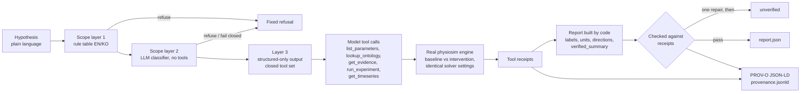

# Ontology-Physiology Lab

[](https://github.com/Carraway-and-Gatsby/ontology-physiology-lab/actions/workflows/research-ci.yml?query=branch%3Ahackathon%2Fexperiment-agent)

A research tool for running synthetic cardiovascular experiments from plain-language hypotheses.

> **Meta Global AI Developer Hackathon entry (Indie track).** This repository is a submission to the Meta Global AI
> Developer Hackathon (event period 2026-10-26 to 2026-11-04). Its experiment agent runs on Meta Muse Spark
> (`muse-spark-1.3`, Meta Model API) by default. It is an independent project, not affiliated with or endorsed by Meta.
>
> **Open source.** Code is released under the [MIT License](LICENSE); documentation and data under
> [CC BY 4.0](LICENSE-docs.md). Third-party material keeps its own terms, listed in [NOTICE.md](NOTICE.md).

> **Safety:** This synthetic research model is not clinically validated and refuses medical-advice requests.

## What it does

- Maps a hypothesis to an ontology-grounded parameter change and runs the real simulation engine.
- Builds a report in code, verifies it against tool receipts, and records each session in W3C PROV-O.
- Uses a three-layer scope guard for research-only operation.
- Re-runs recorded experiments and re-verifies claims in the browser.

## Try it

- [Public research site](https://medical-ontology-research.pages.dev/): [Lab](https://medical-ontology-research.pages.dev/lab/), [simulation](https://medical-ontology-research.pages.dev/simulate/), [ontology graph](https://medical-ontology-research.pages.dev/graph/), and [methodology](https://medical-ontology-research.pages.dev/methodology/).
- Read the [five questions](#five-questions) first: the problem, the ontology, what Meta Muse Spark does, how results are verified, and how this differs from plain LLM report generation. Public-site version: [Five questions](https://medical-ontology-research.pages.dev/overview/).
- After installation, run the offline demo: `.venv/bin/python -m physiosim.agent --dry-run --out agent_eval/my-dry-run`.

## Contents

[Five questions](#five-questions) · [Hackathon](#built-during-the-meta-global-ai-developer-hackathon) · [Agent architecture](#architecture-of-the-experiment-agent) · [Meta models](#how-meta-models-are-used) · [Evaluation](#evaluation) · [Quick start](#quick-start) · [Repository map](#repository-map) · [Scientific limits](#scientific-limits) · [Rights and licenses](#rights-handling) · [Credits](#credits)

<!-- five-questions:start -->
## Five questions

> **Synthetic research model.** Nothing here is clinically validated, patient-specific or medical advice. Not for diagnosis, treatment selection or patient-specific prediction.

### 1. What problem does it solve?

**It lets a researcher turn a plain-language "what if" about a small cardiovascular model into a documented, repeatable engine run, without hand-editing parameters or trusting an unchecked report.**

- A researcher writes a hypothesis such as "In phase1, double the heart rate and compare cardiac output."
- The hypothesis is mapped to named engine parameters that carry units and anatomical context, so the same change can be repeated and inspected.
- The engine is a deterministic closed-loop ODE model: a six-compartment Phase 1 model and an eight-volume four-chamber model, `four_chamber_m1`. Baseline and intervention runs use identical solver settings.
- Every session leaves a report, a trace and a W3C PROV-O provenance record.
- The target is exploring how a small model behaves, not describing a patient.

**Evidence:** [README](README.md), [Phase 1 model](docs/physiology.md), [four-chamber M1 model](docs/physiology_four_chamber_m1.md), [agent documentation](docs/agent.md).

**Limits:** All parameters are synthetic and exploratory, not fitted to measured data. The Phase 1 baseline is elevated-pressure and is not a healthy reference. The models omit, among other things, reflexes, renal regulation, respiration and pharmacology, and valves are ideal diodes.

### 2. Why is an ontology needed?

**A variable name alone does not say what a number means; the ontology attaches a physical property, an anatomical location and a unit to each quantity, so that mismatches can be caught by machine and the model's choice of parameter is grounded in stated concepts.**

- Physical properties come from the Ontology of Physics for Biology (OPB); anatomy uses Uberon as the primary identifier with the cross-referenced FMA term kept; Gene Ontology (GO) terms give process context.
- The connection validator rejects a pressure linked to a flow, left-ventricular pressure linked to right-ventricular pressure, and a link between different units without an explicit conversion.
- The model can only change parameters listed in the engine's parameter catalogue. On this branch 13 of 28 Phase 1 ports and 31 of 36 M1 ports carry ontology bindings (the `hackathon/ontology-completion` branch adds typed contracts for every engine quantity). The model may call `lookup_ontology` and `get_evidence` when useful (they are optional); after the runs, code attaches the evidence relevant to the changed parameters.
- Status: ontology completion work is on the branch `hackathon/ontology-completion`: typed contracts for every engine quantity of both models, vascular contexts, shared blood entities, a dependency graph and resistance-path evidence. Rounds 1 and 2 were reviewed by Claude Opus (an AI model reviewer; the review records are not part of this repository) with the verdict PASS_WITH_NOTES. A unified two-model RDF export and project-specific SHACL shapes are still in progress (round 3). The ontology layer is not complete.

**Evidence:** [ontology documentation](docs/ontology.md), [ontology tests](tests/test_ontology.py), [ontology source](src/physiosim/ontology/).

**Limits:** Source evidence verifies identifiers and labels, not that the project's variable mappings or equations are authoritative ontology entailments. There is no reasoner. The validator checks direct variable equivalence, not biological causation.

### 3. What does Meta Muse Spark actually do?

**Muse Spark (`muse-spark-1.3`, Meta Model API) fills two roles, scope classifier and tool-calling experiment planner; it does not compute any number and it does not write the report.**

- Classifier: one strict-JSON call, without tools, decides whether a request is an in-silico experiment or a medical-advice request. Malformed replies and provider errors are treated as refusals.
- Planner: a tool-calling loop over `list_parameters`, `lookup_ontology`, `get_evidence`, `run_experiment` and `get_timeseries`. The model chooses the model, the intervention, and which runs and metric paths to report.
- Code then builds the report from tool receipts and checks it. Free model text is discarded; only a SHA-256 and a length are kept.
- The Meta preset sends `reasoning_effort: "low"` and gives the classifier a 1,500-token cap, because reasoning tokens count against the completion limit.
- One live session on 2026-11-02, "In phase1, double the heart rate and compare cardiac output.", used 4 model calls (one classifier call, three planner calls) and about 8.8 s of model-call time (about 9.4 s including tool execution). Left-ventricular cardiac output went from 7.704 to 10.047 L/min (+30.418%). The status was `completed_with_warnings` and verification passed. This session is not stored in the repository.

**Evidence:** [README, "How Meta models are used"](README.md#how-meta-models-are-used), [LLM client and presets](src/physiosim/agent/llm.py), [Muse Spark evaluation table](agent_eval/live-2026-11-02/meta.md) and [summary](agent_eval/live-2026-11-02/meta_summary.json).

**Limits:** The evaluation has 27 author-written cases (13 in-scope experiments, 14 out-of-scope requests), one run per provider, on commit `983494e` of this repository (`5c7d171` in the private development repository). Meta, OpenAI `gpt-6.1-terra` and Anthropic `claude-sonnet-5-5` each passed 27/27, so this evaluation does not rank them. Through the agent path, the deterministic rule table (layer 1) stopped all 14 out-of-scope requests for every provider before any agent model call (0 steps, 0 agent tokens), so the LLM classifier's refusal performance was not evaluated through that path. The evaluation harness also calls the classifier on its own for every case: it refused 14/14 out-of-scope and accepted 13/13 in-scope requests for each provider, but these are the same 14 requests the rule table already catches; no case tests a request that evades the rule table. The suite is small and author-designed, not a generalization benchmark. Mapping a hypothesis to parameters still needs researcher review.

### 4. How are the results verified?

**Reported numbers are checked against the engine's own receipts, recorded sessions are re-run in the browser, and the engine is covered by automated tests; this establishes consistency, not physiological truth.**

- Every code-filled field of a report is checked against the session receipts, and the summary text by exact equality. A failed check gets one repair turn, then an `unverified` report.
- The public `/lab/` page holds 81 recorded sessions (27 cases × 3 providers): 39 with engine runs and 42 refusals. The 42 refusals are the same 14 out-of-scope cases recorded once per provider, not 42 independent questions. In the browser (Pyodide), 61 of 61 findings were re-verified and the regenerated summaries matched exactly or within the stated floating-point tolerance; the largest absolute difference was 5.8e-11. Exact-equality checks are relaxed to 1e-8 relative where a different floating-point runtime is not bit-identical. A native re-check found identical summaries and a largest absolute difference of 0.0.
- 36 of those 39 sessions carry the warning `completed_with_warnings`, because the default 12 cycles do not pass the periodicity check.
- The test suite had 523 tests on `hackathon/experiment-agent` (commit `3555f46`; `1487d73` in the private development repository) and 539 on `hackathon/ontology-completion` at round 2 (commit `9714422`; `85ede60` in the private repository, 2026-11-02); these counts were measured locally, the ontology branch count grows as later rounds add tests. Commit hashes in this public repository differ from the private ones because sensitive strings were redacted (see [REDACTIONS.md](REDACTIONS.md)).
- Each session records a PROV-O provenance file.

**Evidence:** [verifier](src/physiosim/agent/verify.py), [report schema](src/physiosim/agent/report.schema.json), [evaluation results](agent_eval/live-2026-11-02/), [independent verification](docs/independent_verification.md), [verification protocol](docs/verification_protocol.md), [public /lab/ page](https://medical-ontology-research.pages.dev/lab/).

**Limits:** A passing check means the report agrees with what the engine computed. It does not check that the hypothesis was mapped to the right parameter, or that the biology is right. Periodicity checks are numerical diagnostics, not convergence proofs. The 27-case evaluation is small.

### 5. How is this different from plain LLM report generation?

**In plain generation the model writes both the numbers and the prose; here the model only chooses which runs and metrics to report, the engine computes the numbers, and code writes and verifies every sentence.**

| | Plain LLM report | This project |
| --- | --- | --- |
| Numbers | Written by the model | Computed by the engine, returned as tool receipts |
| Report sentences | Written by the model | Written by code from receipts; free model text is discarded |
| Check | None unless a person reads it | Receipts compared with the report; exact equality for the summary |
| Repeating it | Depends on the prompt and the model | Recorded sessions re-run in the browser; the engine is deterministic |
| Scope control | Prompt instructions | Rule table, LLM classifier, structured-only output |
| Provenance | Usually none | PROV-O record per session |
| Physiological accuracy | Not verified | Not verified |

**Evidence:** [README, "Report schema v2.1"](README.md#report-schema-v21-the-report-is-authored-by-code), [agent documentation](docs/agent.md), [verifier](src/physiosim/agent/verify.py), [provenance writer](src/physiosim/agent/provenance.py).

**Limits:** No head-to-head experiment against plain LLM generation was run. The table describes design differences, not a measured accuracy gain. The last row is the point: this design makes a report consistent with the engine, not correct about physiology.

### Three kinds of checking, kept separate

- **Semantic consistency.** Meaning, identifiers, units and relations are consistent and machine-checked. It says nothing about whether the physiology is right.
- **Numerical verification.** Reported numbers equal what the engine computed, and the engine solves its equations reproducibly. It says nothing about whether the equations or parameters describe real physiology.
- **Physiological validation.** Comparison with measured human or animal data for a stated context of use. **This has not been done.** All parameters are synthetic and exploratory, and the Phase 1 baseline is elevated-pressure and is not a healthy reference.

Passing the first two checks does not imply the third.
<!-- five-questions:end -->

## Built during the Meta Global AI Developer Hackathon

Event period: 2026-10-26 to 2026-11-04. This public, filtered repository was created on 2026-11-02 (GitHub `created_at` 2026-11-02T10:43:26Z). The first commit is dated 2026-10-31; **every commit in the history is dated inside the event period** (history preserved from the original private repository; sensitive strings and some third-party text redacted, see [REDACTIONS.md](REDACTIONS.md) and [RIGHTS.md](RIGHTS.md)). Commit hashes changed because of the redaction.

**Nothing in this repository predates the event except the third-party inputs listed in [NOTICE.md](NOTICE.md).** The one related earlier project, CardioLab ([Carraway-and-Gatsby/cardiac-simulator](https://github.com/Carraway-and-Gatsby/cardiac-simulator), created 2026-10-23, MIT), was reviewed only; none of its code, model or data is incorporated into the engine or the agent ([docs/ecosystem.md](docs/ecosystem.md)). Captures of its public README/API made during the review are kept as cited evidence.

| Date (commit dates, as recorded) | What was built | Where |
| --- | --- | --- |
| 2026-10-31 | Phase 1 closed-loop engine, 34 annotated variables, semantic benchmark, evidence ledgers, reproducibility scripts; synthetic research CI | `src/physiosim/`, `docs/`, `results/phase1/` |
| 2026-10-31 | Integration stabilization across valve transitions; separation of same-integrator replay from independent solver comparison | `src/physiosim/simulation/`, [docs/independent_verification.md](docs/independent_verification.md) |
| 2026-10-31 to 2026-11-01 | Smith et al. 2004 evidence layer: canonical CellML source and CC BY 3.0 record, OpenCOR reference runs and comparison, literature evidence review, SHACL shapes, PROV-O record of the OpenCOR runs | `docs/evidence/`, `docs/evidence_review/` |
| 2026-11-01 | Anatomical node specification v2, applied to the SHACL layer and the runtime registry; bqbiol vocabulary decision | `src/physiosim/ontology/anatomy_nodes_v2.json`, `docs/evidence_review/` |
| 2026-11-01 | Four-chamber M1 engine (passive atria, eight volumes) and a synthetic demo | [docs/physiology_four_chamber_m1.md](docs/physiology_four_chamber_m1.md), `scripts/run_four_chamber_m1.py` |
| 2026-11-01 to 2026-11-02 | Applied LA–mitral–LV sidecar, review fixes, wheel portability | [docs/applied_la_mitral_lv.md](docs/applied_la_mitral_lv.md), `src/physiosim/ontology/applied_la_mitral_lv.py` |
| 2026-11-02 | Ontology graph viewer | `tools/ontology_graph_view/` |
| 2026-11-02 | Public research site and in-browser Pyodide simulation / re-verification (the agent's tool layer imports without rdflib/pint/matplotlib so it can run in Pyodide) | site build is maintained outside this git history |
| 2026-11-02 | Ontology-grounded experiment agent, then hardening after three cross-provider review rounds (report schema v2, then v2.1: code-authored report) | `src/physiosim/agent/`, `agent_eval/`, [docs/agent.md](docs/agent.md) |

### How the code was written

The code was written with AI coding agents (OpenAI Codex, including gpt-6.1-sol; Claude Opus 5.5 and Sonnet 5.5), orchestrated by Hermes Agent, under a cross-provider routing policy: work implemented by one provider family is reviewed by the other. The agent module had three review rounds (reviewer: Claude Opus 5.5; fixes: Codex gpt-6.1-sol). Decisions that needed a human were made by the repository owner and recorded in [docs/decisions.md](docs/decisions.md) and the evidence-review documents. The routing log is in [docs/orchestration_state.md](docs/orchestration_state.md).

## Model and safety context

Ontology-Physiology Lab is a research tool for running small in-silico cardiovascular experiments from a plain-language model hypothesis. A deterministic closed-loop ODE engine (a six-compartment Phase 1 model and an eight-volume four-chamber model, "M1") is annotated with ontology concepts (Uberon, FMA, OBO Relations Ontology, a Smith et al. 2004 CellML evidence/SHACL layer). On top of it, an experiment agent lets a language model map a hypothesis such as "triple mitral resistance in M1" to engine parameters, call the real engine through tools, and choose which runs and metrics to report. The report itself is built by code from tool receipts and checked against them; the model's free prose is discarded. Each session leaves a W3C PROV-O record.

> **Safety.** All experimental inputs and results are synthetic (the repository also keeps cited third-party evidence and ontology data, listed in NOTICE.md). Nothing here is clinically validated, patient-specific, or medical advice. Parameter defaults are exploratory, not fitted to literature; the Phase 1 baseline is elevated-pressure and must not be described as a healthy adult reference. The agent refuses personal-health, diagnosis, treatment, drug and dosing questions (an English/Korean rule table plus an LLM scope classifier; neither is proof against every paraphrase). **Not for diagnosis, treatment selection or patient-specific prediction.**

Public research site: <https://medical-ontology-research.pages.dev/> — ontology graph viewer (`/graph/`), in-browser simulation (`/simulate/`), `/methodology/`, `/references/`, demos, and `/lab/`, which re-runs the recorded experiments in the browser and re-verifies every claim. Author: Sungyeob Lim, College of Medicine, Soonchunhyang University.

## Architecture of the experiment agent



Details are in [docs/agent.md](docs/agent.md).

### Report schema v2.1: the report is authored by code

- The model authors only `{"model": "phase1|m1", "findings": [{"run_id": "...", "metric_path": "..."}]}`: it chooses a model, parameter ports and interventions through tool calls, and then which runs and which metric paths to report.
- Everything else is filled in by code from the tool receipts: the original hypothesis, parameter changes and baseline overrides, run diagnostics, warnings and caveats, ontology and evidence receipts, finding values, labels, units and directions (with a numerical tolerance, so a change inside solver tolerance is `unchanged`), and the `verified_summary` text.
- Model-supplied copies of those fields are discarded, even when fabricated. Free model text is never stored or shown; only a SHA-256 and length receipt is kept in the trace and provenance, so no free model text appears in outputs.
- Each code-filled field is independently verified against the session receipts, and the verifier checks the summary by exact equality. A failed check gets one report-only repair turn (no tools), then a minimal `unverified` envelope.
- Status is one of `completed`, `completed_with_warnings`, `unverified`, `refused`, `error`, `stopped_budget` (closed envelopes in `src/physiosim/agent/report.schema.json`; historical `2.0` reports stay readable).
- Per-session limits: 180 s wall clock, 6 experiments, 8 ordinary model calls (plus one classifier call and one repair call), solver cycles capped at 80. Pairs of runs use identical solver settings; a short-run or non-periodic condition produces a warning.

### Three-layer scope guard

1. **Rule table** (`guard.py`): normalized English/Korean patterns for personal-health, diagnosis, treatment, drug and dosing requests. Runs before any provider is created.
2. **LLM scope classifier**: one same-provider call, without tools, that must return a strict `{"in_scope", "reason"}` JSON object; malformed replies, tool calls and provider errors fail closed.
3. **Structured-only output**: the model can only choose runs and metrics; every sentence in a report (verified summary, labels, caveats, refusal text) is generated by code, and free model text is never stored or shown (trace and provenance keep only its SHA-256 and length). The tool-calling model also gets a research-only system prompt and a closed set of engine/ontology tools.

The guard is not proof against every language or adversarial paraphrase.

### Re-verification in the browser

The `/lab/` page of the public site re-runs the recorded experiments in the browser (Pyodide, no server) and re-verifies every claim against the engine's receipts. The site build is maintained outside this repository.

## How Meta models are used

The agent speaks the OpenAI-compatible Chat Completions protocol through a standard-library client (`src/physiosim/agent/llm.py`). Provider presets:

| `--provider` | Base URL | Default model | Credential variable |
| --- | --- | --- | --- |
| `meta` | `https://api.meta.ai/v1` | `muse-spark-1.3` | `MODEL_API_KEY` |
| `openai` | `https://api.openai.com/v1` | none (use `--model`) | `OPENAI_API_KEY` |
| `anthropic` | `https://api.anthropic.com/v1` | none (use `--model`) | `ANTHROPIC_API_KEY` |
| `custom` | `LAB_LLM_BASE_URL` (plain HTTP only for loopback) | `LAB_LLM_MODEL` | `LAB_LLM_API_KEY` (optional) |

`custom` accepts any OpenAI-compatible endpoint, for example an open-weight model served locally.

### Muse Spark in this project

Meta **Muse Spark** (`muse-spark-1.3`, Meta Model API) is the default model of the agent (`--provider meta`) and fills **both LLM roles**:

1. **Scope classifier**: one strict-JSON call that decides whether a request is an in-silico model experiment or a medical-advice request (refused, fail-closed).
2. **Experiment planner**: the tool-calling loop that reads the parameter catalogue, grounds the hypothesis in the ontology (`lookup_ontology`), chooses the intervention, calls the real engine (`run_experiment`), and picks which runs and metrics answer the hypothesis. Code then writes and verifies the report.

Muse Spark is a reasoning model: the `meta` preset sends `reasoning_effort: "low"` and gives the classifier a 1,500-token cap, because reasoning tokens count against the completion limit (a 200-token cap returned empty content in live testing, which the fail-closed guard turned into refusals). On the evaluation below Muse Spark passed 27/27 cases. OpenAI and Anthropic models are supported through the same interface and were evaluated for comparison.

## Evaluation

`agent_eval/hypotheses.json` holds 27 cases: 13 in-scope experiments across both models (mitral resistance, LV peak elastance, heart rate, systemic and pulmonary resistance, arterial compliance, initial volume, review counter-examples and three formerly refused experiment phrasings) and 14 out-of-scope clinical requests that must be refused, including Korean. Expected signs were obtained by executing the engine, not from textbooks.

Live runs, 2026-11-02, on commit `983494e` (`5c7d171` in the private repository; same agent code as this branch), report schema 2.1, produced by `python agent_eval/run_eval.py`. Numbers are computed from the per-provider `results.json` files that the harness wrote; per-case tables, summaries and the full per-provider `<provider>_results.json` files (about 3 MB each; SHA-256 in `SHA256SUMS`) are committed in [agent_eval/live-2026-11-02/](agent_eval/live-2026-11-02/), so the table below can be recomputed from the repository; the sessions are also replayed on the public site's /lab/ page.

| Provider / model | Date | Cases (in / out of scope) | Passed all checks | Parameter mapping | Tool use | Verifier | Guard | Classifier | Sign agreement (in-scope) | Tokens (total; mean per in-scope case) | Latency (total; mean per in-scope case) |
| --- | --- | --- | --- | --- | --- | --- | --- | --- | --- | --- | --- |
| meta / muse-spark-1.3 (preset default) | 2026-11-02 | 27 (13 / 14) | 27/27 | 27/27 | 27/27 | 27/27 | 27/27 | 27/27 | 13/13 | 338,386; 26,030 | 135.3 s; 10.4 s |
| openai / gpt-6.1-terra | 2026-11-02 | 27 (13 / 14) | 27/27 | 27/27 | 27/27 | 27/27 | 27/27 | 27/27 | 13/13 | 322,912; 24,839 | 107.9 s; 8.3 s |
| anthropic / claude-sonnet-5-5 | 2026-11-02 | 27 (13 / 14) | 27/27 | 27/27 | 27/27 | 27/27 | 27/27 | 27/27 | 13/13 | 629,565; 48,428 | 146.0 s; 11.2 s |

How to read it:

- All 13 in-scope cases ended `completed_with_warnings` and all 14 out-of-scope cases ended `refused`. In every case the 14 refusals came from the deterministic rule table before any model call (0 tokens), so the classifier ran on the 13 in-scope cases only; the harness scores a deterministic refusal as a correct classifier outcome.
- "Tool use" and "Parameter mapping" are scored per case by the harness (see `agent_eval/run_eval.py` for the exact rules, including how refusals are scored).
- Means per in-scope case exclude the zero-token refusals. Tokens are the providers' reported usage summed over classifier and model calls.
- This is a small, self-written suite, one run per provider, with no variance estimate. "Tool consistency does not establish physiological or clinical validity": passing means the report agrees with the engine's receipts, not that the biology is right. Semantic mapping from hypothesis to parameter still needs researcher review.

## Quick start

Requires Python 3.11+.

```sh
python3.11 -m venv .venv
.venv/bin/pip install -r requirements.lock -e .
.venv/bin/python -m pytest -q
```

Run the offline scripted demo (no network, still executes the real engine):

```sh
.venv/bin/python -m physiosim.agent --dry-run --out agent_eval/my-dry-run
```

Run the agent on a hypothesis. Keys are read from the environment only, never from arguments:

```sh
export MODEL_API_KEY=...            # Meta Model API
.venv/bin/python -m physiosim.agent "Triple mitral resistance in M1 and compare LA pressure and stroke volume" --provider meta --out agent_eval/meta-run

export OPENAI_API_KEY=...
.venv/bin/python -m physiosim.agent "Halve emax_lv in phase1 and compare cardiac output" --provider openai --model YOUR_MODEL --out agent_eval/openai-run

export ANTHROPIC_API_KEY=...
.venv/bin/python -m physiosim.agent "Increase systemic resistance by 50% in M1" --provider anthropic --model YOUR_MODEL --out agent_eval/anthropic-run
```

Use a new `--out` directory for each run; existing output files are refused. Output: `report.json`, `trace.json`, `provenance.jsonld`. The exit status is nonzero when verification fails. Run the evaluation harness with `python agent_eval/run_eval.py --provider fake --out agent_eval/my-fake-eval` (replace `fake` with a live provider when credentials are set); the fake provider measures orchestration only, not language-model ability.

The deterministic engine itself needs no LLM or network after installation:

```sh
.venv/bin/python -m physiosim --config experiments/phase1.json --output results/phase1
.venv/bin/python scripts/run_four_chamber_m1.py --output results/m1
```

Open `results/phase1/index.html` in a browser to see the Phase 1 result viewer. Exit status 0 means the runtime conservation/positivity/valve audit and the declared periodicity gate passed (status 2: at least one scenario is transient/non-periodic; status 1: execution/configuration error). This is not biological validation. The canonical experiment uses 60 cycles, 400 samples/cycle, DOP853, rtol=1e-9, atol=1e-10 mL and maximum step T/200.

To verify a clean wheel installation and repeatability (same-host replay, not cross-platform bitwise identity):

```sh
uv build --wheel
uv venv --python 3.11 .clean-venv
uv pip install --python .clean-venv/bin/python -r requirements.lock dist/ontology_physiosim-0.1.0-py3-none-any.whl
.clean-venv/bin/python scripts/verify_reproducibility.py
.clean-venv/bin/python scripts/verify_independent.py
.clean-venv/bin/python -I -m pytest -q
```

## Repository map

| Path | Content |
| --- | --- |
| `src/physiosim/models`, `simulation`, `validation`, `experiments` | Phase 1 six-compartment engine, solver, audits, experiment runner |
| `src/physiosim/ontology/` | Variable registry, unit-checked bindings, anatomical node spec v2, four-chamber M1 manifest, applied LA–mitral–LV sidecar |
| `src/physiosim/agent/` | Experiment agent: catalogue, tools, guard, verifier, narrative, provenance, LLM client, CLI |
| `agent_eval/` | Evaluation cases, reference runs, harness, offline outputs |
| `tools/ontology_graph_view/` | Offline ontology graph viewer and its inputs |
| `docs/` | Physiology, ontology, ecosystem review, verification protocol, agent documentation, decisions, evidence ledgers |
| `docs/evidence/`, `docs/evidence_review/` | Retained retrieval evidence (some captures are stubs, see [RIGHTS.md](RIGHTS.md)) and the Smith 2004 evidence/SHACL/PROV-O review |
| `docs/verification/`, `docs/validation/`, `docs/research_strategy/` | Design-only methodologies of 2026-11-03: model verification (equations solved correctly), physiological validation (predictions against measured data), and the dual-track research strategy audit, Research Gate 1 and evidence registers. Nothing in them is executed or claimed as passed |
| `results/` | Phase 1 outputs recorded by the initial commit (2026-10-31; the current code gives slightly different trajectories, see [results/phase1/CURRENT_CODE_COMPARISON.md](results/phase1/CURRENT_CODE_COMPARISON.md)) and reproducibility records |
| `tests/` | Numerical, dimensional, semantic, agent, wheel-portability tests |
| [REDACTIONS.md](REDACTIONS.md) | What was redacted for the public release |
| [RIGHTS.md](RIGHTS.md) | Third-party rights decisions: which captures are stubs and why |

## Scientific limits

The models omit (Phase 1) separate atria and (both) septal/pericardial interaction, valve inertia, nonlinear passive ventricular mechanics, reflexes, renal regulation, respiration, oxygen transport and pharmacology. Valves are ideal diodes. M1 atria are passive. Parameter defaults are exploratory. The model is not a replication of Smith et al. (2004). Periodicity checks are numerical diagnostics, not convergence proofs. Pass/fail of semantic checks is not biological validation. The semantic benchmark is a small hand-designed synthetic fault-injection experiment. Pulmonary venous pressure in Phase 1 is a lumped reservoir pressure, not a measured atrial pressure. No drug-dose or PK/PD model is included. See `docs/` for the full limits.

## Rights handling

Some files in the retained evidence set are third-party captures (web pages, publisher abstracts, license-restricted text). For the public release these were filtered: whole captures without a redistribution license are replaced by stubs at the same path (source, retrieval date, original SHA-256 and size are kept; the content is **not redistributed, cited only**), and selected publisher abstracts are replaced by `[abstract omitted: publisher copyright; see DOI/PMID]`. Ledger SHA-256 values refer to the original bytes. [RIGHTS.md](RIGHTS.md) lists every decision; [REDACTIONS.md](REDACTIONS.md) lists privacy redactions (local paths, host names, request identifiers). License screening is technical due diligence, not legal advice.

## Licenses

- Code: MIT, see [LICENSE](LICENSE).
- Documentation and authored data: CC BY 4.0, see [LICENSE-docs.md](LICENSE-docs.md), which also lists third-party files that keep their own licenses.
- Third-party components and data: [NOTICE.md](NOTICE.md); per-file rights decisions: [RIGHTS.md](RIGHTS.md).

## Credits

Sungyeob Lim, College of Medicine, Soonchunhyang University. Smith et al. 2004 CellML model: Smith BW, Chase JG, Nokes RI, Shaw GM, Wake G, *Medical Engineering & Physics* 26 (2004) 131–139; CellML encoding by Geoffrey Nunns, Auckland Bioengineering Institute, via the Physiome Model Repository (Lloyd et al., *Bioinformatics* 2008;24(18):2122–2123).
